# 🎨 Power Paint - Real-Time Collaborative Drawing App

> Power Paint - это масштабируемое веб-приложение для совместного рисования в реальном времени, разработанное с использованием современных подходов к построению распределённых систем и фронтенд-архитектуры.

## 🚀 Основные возможности

- Совместное рисование в реальном времени
- Мгновенная синхронизация через WebSocket
- Консистентность данных с использованием CRDT движка
- Поддержка и полный контроль мультипользовательских сессий
- Интеграция безопасной аутентификации через OpenID Connect
- Темизация и интернационализация интерфейса
- Полный стек тестирования, включая E2E тесты
- Email-рассылки с кодами подтверждения
- Адаптивный интерфейс

## 🏗 Архитектура

Монорепозиторий на yarn workspaces. Клиент общается только со шлюзом, сервисы между собой - по HTTP и через события Redis.

```
apps/
├── web        Next.js - интерфейс и серверный рендеринг, своей API-логики нет
├── gateway    Express - единая точка входа, rate limit и проверка сессии
├── auth       NestJS - регистрация, вход, OAuth, сброс пароля, интроспекция
├── users      NestJS - профили пользователей
├── boards     NestJS - доски, рабочие области и права доступа
├── collab     Hocuspocus - WebSocket и синхронизация рисунка через CRDT
└── migrator   миграции Prisma, применяются до старта остальных сервисов

packages/
├── contracts  zod-схемы и типы, общие для сервисов и фронтенда
├── db         клиент Prisma и схема базы
└── events     события через Redis Streams: публикация, группа потребителей, рассылка всем экземплярам
```

Каждый сервис работает со своей схемой PostgreSQL и не читает чужие таблицы - данные соседнего домена запрашиваются по HTTP. Шлюз отвечает на вопрос «кто ты», сервис - на вопрос «что тебе можно».

## 🧩 Технологический стек

### Frontend

- [React](https://react.dev)
- [Next.js](https://nextjs.org)
- [TypeScript](https://www.typescriptlang.org)
- [Feature-Sliced Design](https://fsd.how)
- [TailwindCSS](https://tailwindcss.com)
- [Zustand](https://zustand-demo.pmnd.rs)
- [React Query](https://tanstack.com/query)

### Backend / Infra

- [Node.js](https://nodejs.org)
- [NestJS](https://nestjs.com)
- [Express](https://expressjs.com)
- [WebSocket](https://en.wikipedia.org/wiki/WebSocket)
- [Yjs](https://yjs.dev) + [Hocuspocus](https://tiptap.dev/docs/hocuspocus)
- [PostgreSQL](https://www.postgresql.org)
- [Prisma ORM](https://www.prisma.io)
- [Redis](https://redis.io)
- [Zod](https://zod.dev)

### [Email](#-email-система)

- [Nodemailer](https://nodemailer.com)
- [React Email](https://react.email)

### DevOps

- [Nginx](https://www.nginx.com)
- [Docker](https://www.docker.com)
- [DuckDNS](https://www.duckdns.org)

### [Testing](#-тестирование)

- [Jest](https://jestjs.io)
- [Testing Library](https://testing-library.com)
- [Playwright](https://playwright.dev)

# Быстрый старт

### 📦 1. Клонирование репозитория

```bash
git clone https://github.com/Wo0zZ1/power-paint
```

### ⚙️ 2. Настройка переменных окружения

Cкопируй и заполни корневой `.env` файл.

```bash
cp .env.example .env
```

> TIP: `.env` в корне - единственный источник переменных: docker compose раздаёт их сервисам сам.

### 🐋 3. Запуск в Docker

Для запуска всех сервисов в продакшн-режиме:

```bash
docker compose -f docker-compose.yml --env-file .env up -d --build
```

Для запуска системы в dev-режиме и дальнейшей разработки фронтенда, развёрнутого на localhost:

```bash
docker compose -f docker-compose.web-dev.yml --env-file .env.dev up -d --build
```

## 🧪 Тестирование

### Unit + Integration

Запуск из корня монорепозитория:

```bash
yarn test
```

Тесты, которым нужны Redis и Postgres, по умолчанию пропускаются. Чтобы прогнать и их:

```bash
RUN_INTEGRATION_TESTS=true yarn test
```

### E2E тесты

Переносятся на новую структуру монорепозитория.

## 🌐 Деплой

Вся инфраструктура веб-приложения развёрнута на [VPS](https://beget.com/ru)

## 📂 Структура `apps/web`

Структура фронтенд-приложения построена по принципам Feature-Sliced Design, что обеспечивает высокую масштабируемость и поддерживаемость кода.

```
.
├── app/          # Роутинг и инициализация
├── email/        # Шаблоны для email-рассылок
├── public/       # Статические ресурсы
└── src/
    ├── app       # Глобальные провайдеры
    ├── entities  # Доменные сущности
    ├── features  # Бизнес-логика
    ├── shared    # Общие утилиты и UI-kit
    └── widgets   # Композиция UI
```

Роутинг реализован с помощью [App Router](https://nextjs.org/docs/app) и вынесен в отдельный слой `/app`, что позволяет легко управлять навигацией и поддерживать чистую архитектуру, не смешивая логику со слоем `/src/app`

## 📬 Email-система

Power Paint включает в себя встроенную систему email-рассылок, которая используется для отправки кодов подтверждения при регистрации и других уведомлений. Основные компоненты системы включают:

- Шаблоны email, разработанные с помощью [React Email](https://react.email), что позволяет создавать адаптивные и красивые письма.
- Отправка писем осуществляется через SMTP-сервер с помощью [Nodemailer](https://nodemailer.com), обеспечивая надёжную доставку сообщений пользователям.

> TIP: Для E2E тестирования поднимается отдельный сервис [MailHog](https://github.com/mailhog/MailHog), который перехватывает все исходящие письма и позволяет просматривать их через веб-интерфейс, что обеспечивает удобное тестирование email-функционала без риска отправки реальных писем.

## Почему Power Paint?

> Power Paint - это не просто ещё одно приложение для рисования, а полноценная платформа для совместной работы, которая решает ключевые проблемы существующих решений на рынке. Вот почему Power Paint выделяется:

| Аналог     | Ограничение             | Преимущества Power Paint                |
| ---------- | ----------------------- | --------------------------------------- |
| Excalidraw | Нет ролевой модели      | Полный контроль над сессиями            |
| Draw.io    | Медленная синхронизация | Мгновенная синхронизация                |
| Figma      | Проприетарность         | Открытый код и возможность кастомизации |

| Use case / сценарий                          | Power Paint | Excalidraw | Draw.io | Figma |
| -------------------------------------------- | ----------- | ---------- | ------- | ----- |
| Быстрые скетчи и идеи                        | ✅          | ✅         | ⚠️      | ⚠️    |
| Совместное редактирование в реальном времени | ✅          | ✅         | ⚠️      | ✅    |
| Работа в распределённых командах             | ✅          | ⚠️         | ⚠️      | ✅    |
| Контроль доступа (роли, права)               | ✅          | ⚠️         | ⚠️      | ✅    |
| развёртывание на своей инфраструктуре        | ✅          | ✅         | ✅      | ❌    |
| Использование в обучении / преподавании      | ✅          | ✅         | ⚠️      | ⚠️    |
| Brainstorming / whiteboard-сессии            | ✅          | ✅         | ⚠️      | ⚠️    |

👉 Power Paint:

- Open-source
- Масштабируемый
- Контролируемый стек
- Подходит для enterprise

## Демо

### Регистрация

#### Страница регистрации, Шаг 1: Ввод email и отправка кода подтверждения

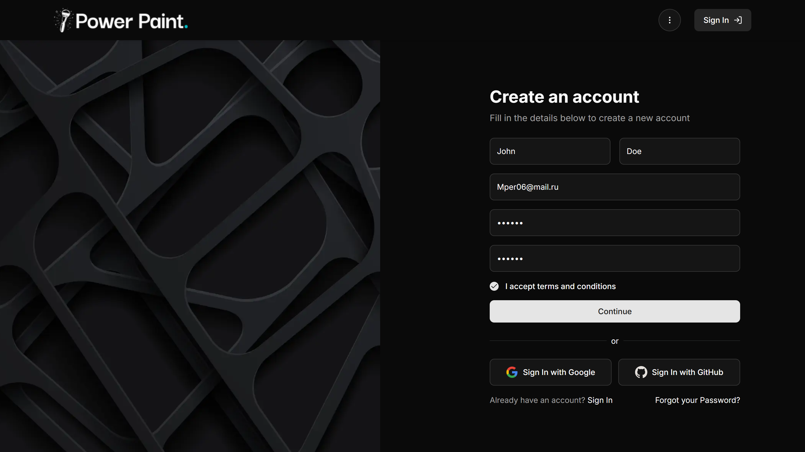

#### Страница регистрации, Шаг 2: Ввод дополнительных данных и завершение регистрации

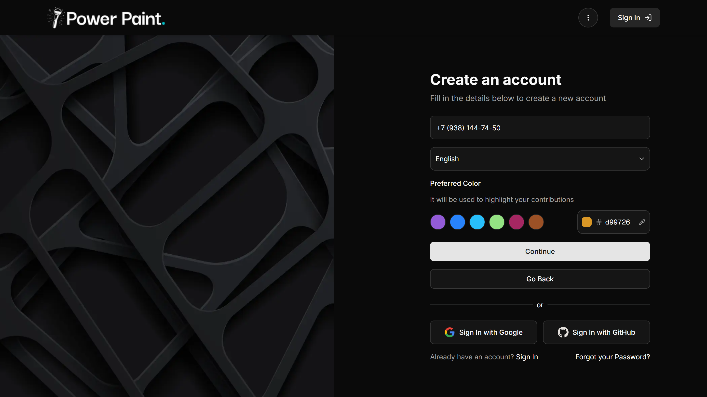

#### Страница регистрации, Шаг 3: Ввод кода подтверждения из email

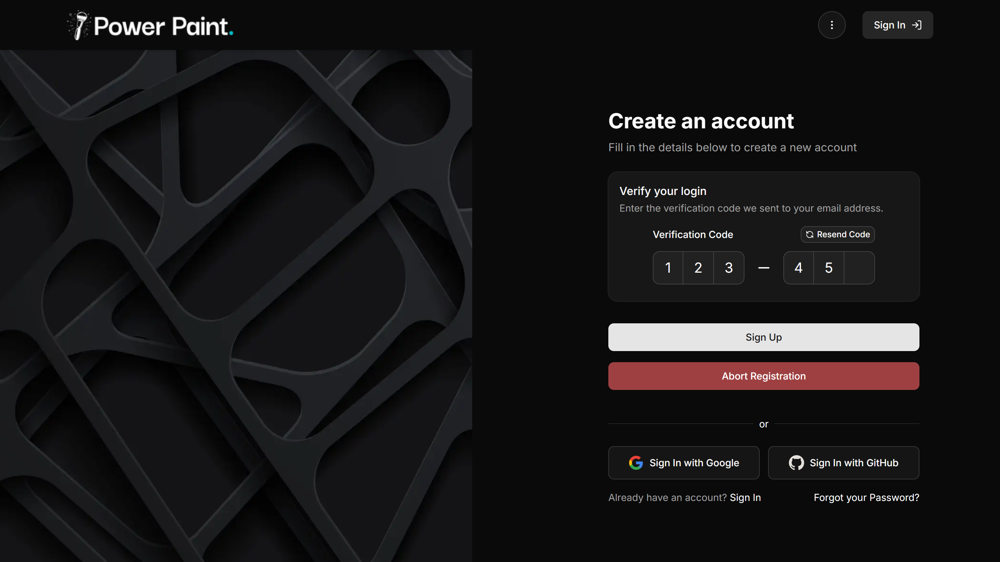

### Восстановление пароля

#### Страница восстановления пароля, Шаг 1: Ввод email и отправка кода подтверждения

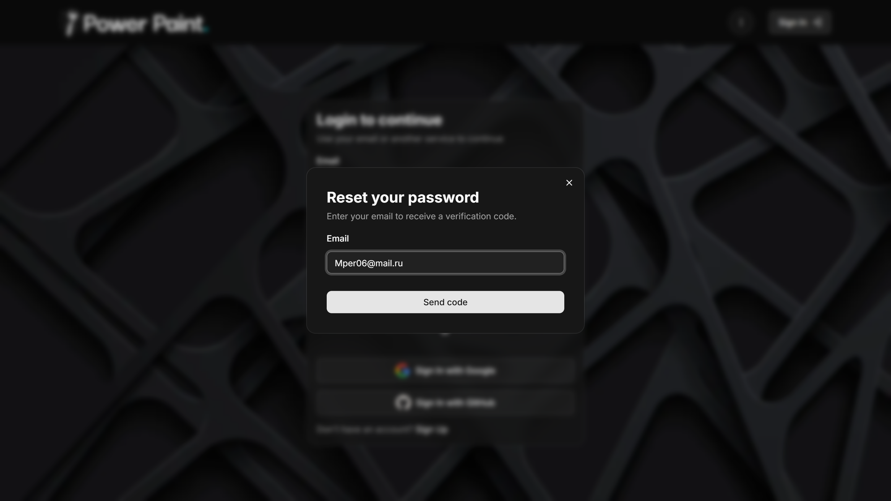

#### Страница восстановления пароля, Шаг 2: Ввод кода подтверждения из email

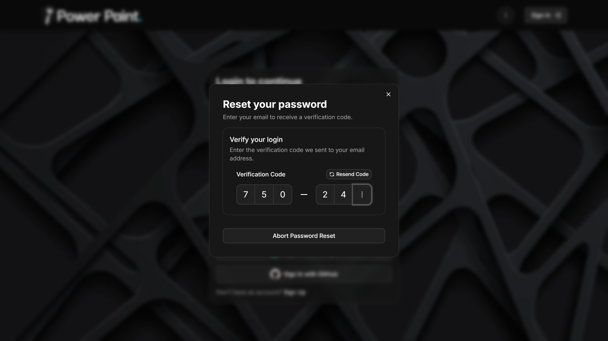

#### Страница восстановления пароля, Шаг 3: Ввод нового пароля и завершение процесса

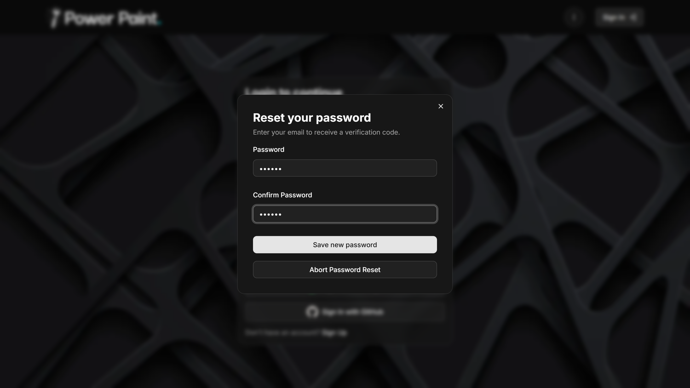

### Вход

#### Страница входа: Ввод email и пароля

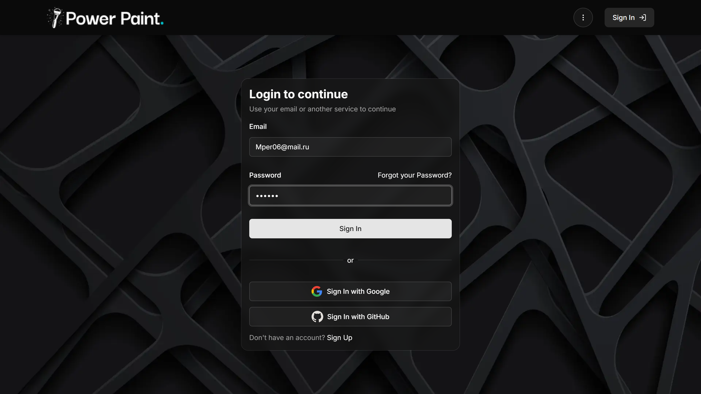

### Главная страница

#### Тёмная тема + Интернационализация (английский язык)

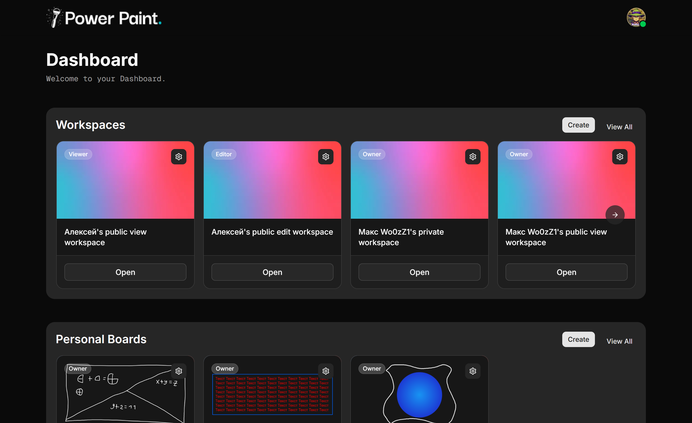

#### Светлая тема + Интернационализация (русский язык)

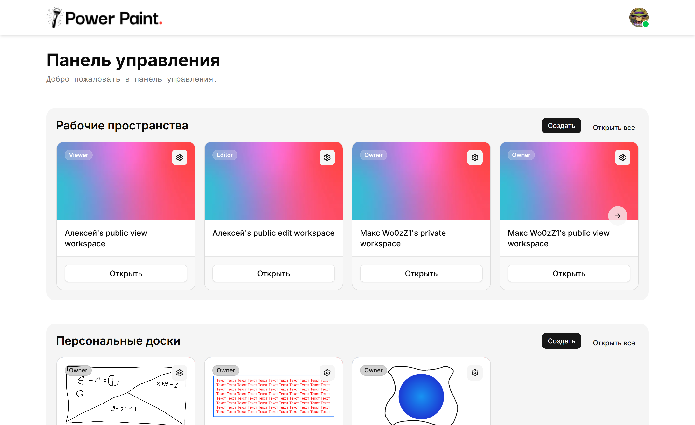

#### Настройка доступа к рабочей области

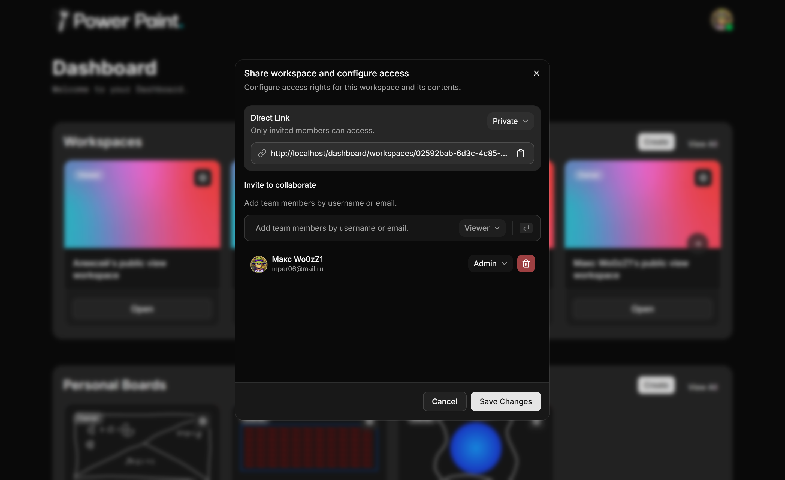

### Email-рассылки

#### Пример письма с кодом подтверждения для регистрации

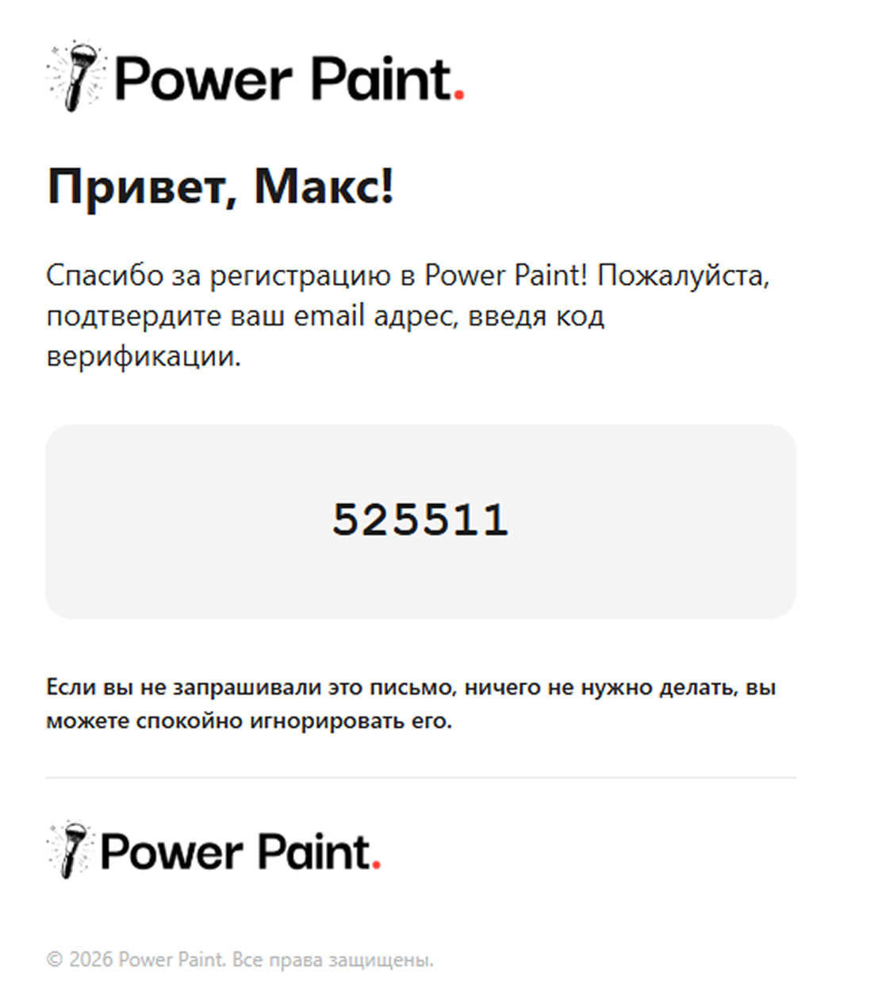

#### Пример письма с кодом подтверждения для восстановления пароля

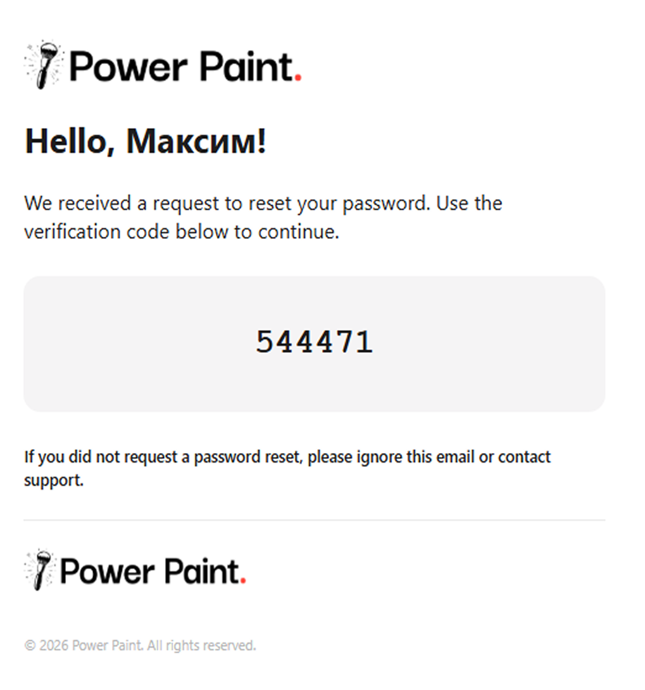

### Рисование

#### Совместное рисование в реальном времени

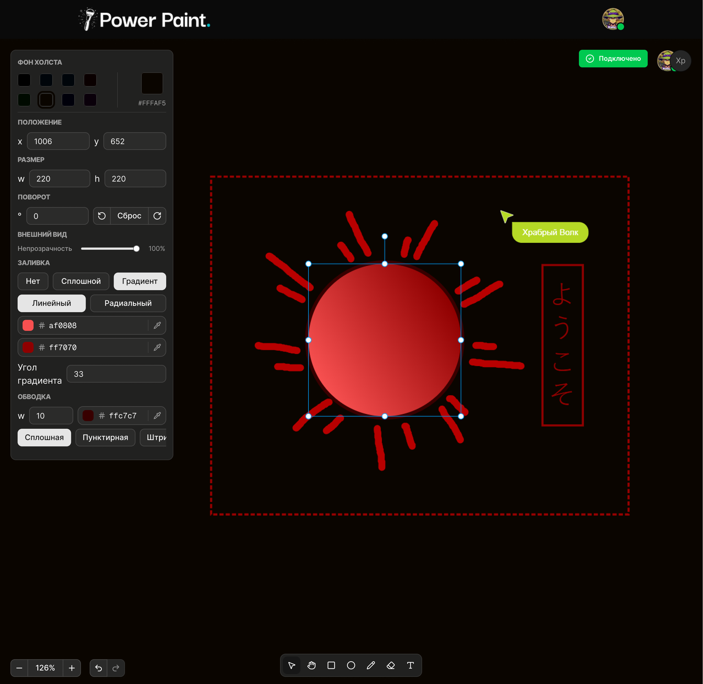

### Тестирование

#### Unit&Integration-тесты

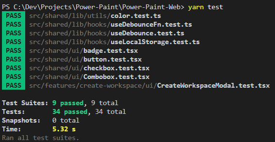

#### E2E-тесты

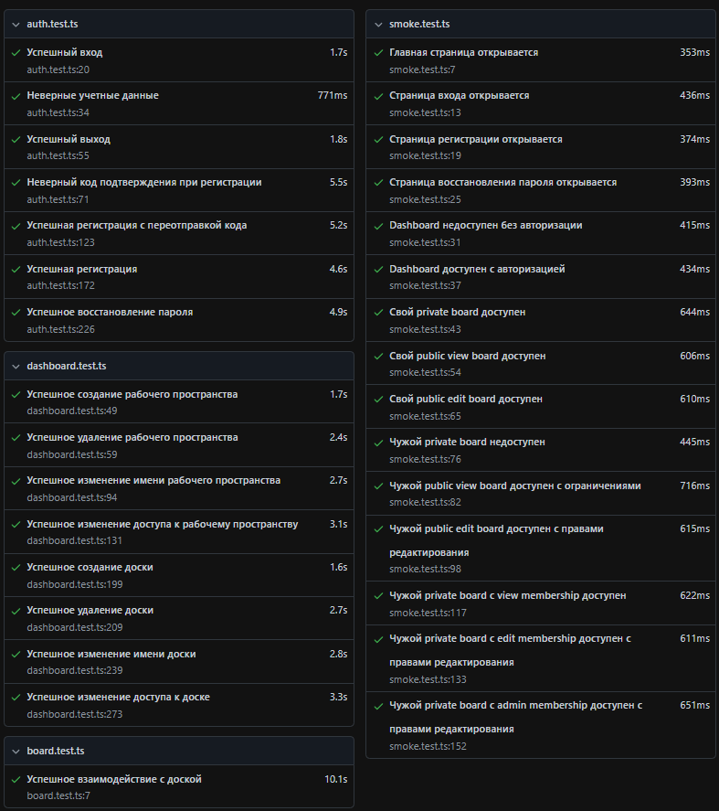

#### Lighthouse отчёт

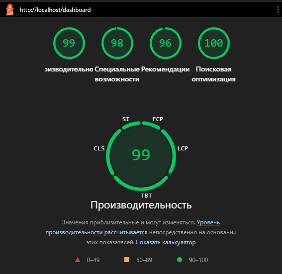

#### Lighthouse метрики

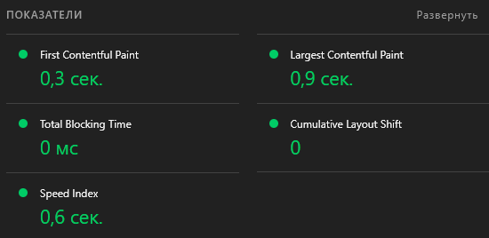

---

Разработано в рамках курсовой работы 2026

## 📄 Лицензия

Проект распространяется под лицензией [MIT](LICENSE)
